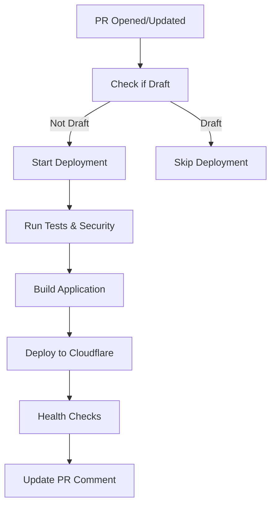

# Preview Deployment System

## Overview

This system provides automated preview deployments for all pull requests to the main branch, enabling safe testing and review of changes before they are merged to production.

## Features

### 🚀 Automated Deployments
- **Trigger**: Automatically triggered when PRs are opened, synchronized, or reopened
- **Unique URLs**: Each PR gets a unique preview URL (`preview-pr-{number}.pages.dev`)
- **Environment**: Uses staging database with preview-specific configuration
- **Cleanup**: Automatically cleaned up when PR is closed

### 🔍 Comprehensive Testing
- **Health Checks**: Progressive health checks with retry logic
- **Smoke Tests**: Automated smoke tests on deployment
- **Validation**: Environment and configuration validation
- **Error Handling**: Detailed error reporting and recovery

### 📊 PR Integration
- **Status Comments**: Detailed deployment status in PR comments
- **Testing Checklist**: Comprehensive testing guidelines for reviewers
- **Deployment Info**: Technical details and quick links
- **Progress Updates**: Real-time deployment progress updates

## Workflow

### 1. PR Creation/Update


### 2. Deployment Process
1. **Validation**: Environment variables and configuration
2. **Building**: Application built with preview settings
3. **Deployment**: Deployed to Cloudflare Pages with unique branch
4. **Verification**: Health checks with progressive retry
5. **Testing**: Automated smoke tests
6. **Notification**: PR comment with deployment details

### 3. PR Closure
1. **Cleanup Trigger**: Triggered when PR is closed
2. **Resource Cleanup**: Cloudflare deployment removed
3. **Notification**: PR comment confirming cleanup

## Usage

### For Developers

#### Creating a PR with Preview
1. Push changes to a feature branch
2. Create PR against main branch
3. Wait for automated deployment (3-5 minutes)
4. Review deployment comment for preview URL
5. Test functionality on preview deployment

#### Testing Locally
```bash
# Test preview configuration locally
npm run preview:test

# Manual preview deployment (for testing)
npm run deploy:preview

# Cleanup preview deployment
npm run cleanup:preview
```

### For Reviewers

#### Review Checklist
When reviewing PRs, test the following on the preview deployment:

**✅ Functional Testing**
- [ ] Core features work correctly
- [ ] Authentication functions properly
- [ ] API endpoints respond correctly
- [ ] Database operations work
- [ ] Error handling is appropriate

**🎨 UI/UX Testing**
- [ ] Visual design is correct
- [ ] Responsive layout works
- [ ] Interactive elements function
- [ ] Loading states display properly
- [ ] Accessibility is maintained

**🔒 Security Testing**
- [ ] Authentication is enforced
- [ ] Authorization works correctly
- [ ] No sensitive data exposed
- [ ] Input validation works
- [ ] Error messages don't leak info

**⚡ Performance Testing**
- [ ] Page load times acceptable
- [ ] API response times good
- [ ] No console errors
- [ ] Bundle size impact reasonable

## Configuration

### Environment Variables

#### Required for Preview
```bash
# Database (uses staging)
DATABASE_URL=<staging_database_url>

# Authentication
JWT_SECRET=<jwt_secret>
NEXTAUTH_SECRET=<nextauth_secret>

# At least one AI API key
CLAUDE_API_KEY=<claude_key>
OPENAI_API_KEY=<openai_key>
MISTRAL_API_KEY=<mistral_key>

# Cloudflare (for deployment)
CLOUDFLARE_API_TOKEN=<api_token>
```

#### Preview-Specific Settings
```bash
NODE_ENV=preview
APP_ENV=preview
NEXT_PUBLIC_APP_ENV=preview
NEXT_PUBLIC_ENVIRONMENT=preview
PR_NUMBER=<pr_number>
GITHUB_HEAD_REF=<branch_name>
GITHUB_SHA=<commit_sha>
```

### Wrangler Configuration
```toml
[env.preview]
name = "zeidgeist-prompter-preview"
vars = { 
  NODE_ENV = "preview", 
  APP_ENV = "preview", 
  API_BASE_URL = "https://preview.mstprmpt.zeidgeist.com" 
}
```

## Files and Scripts

### GitHub Workflows
- `.github/workflows/ci.yml` - Enhanced with preview deployment job
- `.github/workflows/pr-preview.yml` - Dedicated preview management workflow

### Deployment Scripts
- `scripts/deployment/deploy-preview.js` - Preview deployment orchestration
- `scripts/deployment/cleanup-preview.js` - Preview cleanup automation
- `scripts/setup-preview-testing.js` - Local testing and validation

### Configuration Files
- `app/lib/config/preview-environment.js` - Preview-specific configuration
- `.github/pull_request_template.md` - PR template with testing guidelines

### Package.json Commands
```json
{
  "deploy:preview": "node scripts/deployment/deploy-preview.js",
  "cleanup:preview": "node scripts/deployment/cleanup-preview.js",
  "preview:test": "node scripts/setup-preview-testing.js"
}
```

## Security Considerations

### Preview Environment Security
- **Database**: Uses staging database (not production)
- **Rate Limiting**: Relaxed limits for testing
- **CORS**: Permissive CORS for cross-origin testing
- **Authentication**: Same security as staging
- **API Keys**: Uses staging/development keys when possible

### Resource Management
- **Auto Cleanup**: Deployments automatically cleaned up
- **Concurrency**: Prevents multiple deployments per PR
- **Resource Limits**: Cloudflare Pages free tier limits apply

## Troubleshooting

### Common Issues

#### Deployment Fails
1. Check GitHub Actions logs for specific errors
2. Verify environment variables are set correctly
3. Ensure Cloudflare API token has correct permissions
4. Check if build process completes successfully

#### Health Checks Fail
1. Wait for deployment propagation (up to 5 minutes)
2. Check if application starts correctly
3. Verify database connectivity
4. Check for JavaScript errors in browser console

#### Preview URL Not Accessible
1. Verify deployment completed successfully
2. Check Cloudflare Pages dashboard
3. Wait for DNS propagation
4. Try accessing health check endpoint first

### Debug Commands
```bash
# Check deployment status
wrangler pages deployment list --project-name=zeidgeist-prompter

# View deployment logs
wrangler pages deployment tail --project-name=zeidgeist-prompter

# Test local build
NODE_ENV=preview npm run build

# Test health endpoints
curl https://preview-pr-{number}.pages.dev/api/health/liveness
```

## Best Practices

### For Development
1. **Test Locally**: Use `npm run preview:test` before pushing
2. **Keep PRs Small**: Smaller PRs deploy faster and are easier to test
3. **Update Descriptions**: Keep PR descriptions clear and detailed
4. **Monitor Deployments**: Check deployment status in PR comments

### For Review
1. **Test Thoroughly**: Follow the complete testing checklist
2. **Check Multiple Devices**: Test responsive design
3. **Verify Performance**: Ensure no performance regressions
4. **Document Issues**: Report any issues found during testing

### For Maintenance
1. **Monitor Costs**: Keep track of Cloudflare Pages usage
2. **Update Dependencies**: Keep deployment scripts updated
3. **Review Logs**: Regularly check deployment logs for issues
4. **Cleanup Orphans**: Occasionally check for orphaned deployments

## Limitations

- **Database**: Uses staging database (may have different data)
- **Performance**: May be slower than production due to preview settings
- **Analytics**: No analytics tracking in preview
- **Monitoring**: Limited monitoring compared to production
- **SSL**: Uses Cloudflare-provided SSL (not custom domain SSL)

## Support

For issues with preview deployments:
1. Check the GitHub Actions workflow logs
2. Review the PR deployment comment for error details
3. Test locally using `npm run preview:test`
4. Contact the development team for persistent issues