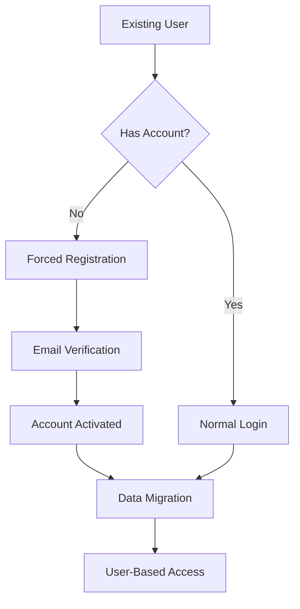

# Authentication System Rollout Plan
## Phased Deployment Strategy

### Overview
Deploy the new OAuth 2.1 + OIDC authentication system with zero-downtime migration from IP-based to user-based isolation.

---

## 🚀 Phase 1: Internal Team (Day 3) - 10 Users

### Objectives
- Validate authentication flow with known users
- Test MFA setup and usage
- Verify token validation and session management
- Identify any critical issues before wider rollout

### Target Users
- Development team (5 users)
- QA team (3 users)
- Product managers (2 users)

### Deployment Steps
```bash
# 1. Deploy auth service with feature flag
kubectl set env deployment/api AUTH_ENABLED=true
kubectl set env deployment/api AUTH_ROLLOUT_PERCENTAGE=0

# 2. Create internal user whitelist
kubectl create configmap auth-whitelist --from-literal=emails="dev1@company.com,dev2@company.com,qa1@company.com"

# 3. Enable for whitelisted users only
kubectl set env deployment/api AUTH_WHITELIST_ENABLED=true
```

### Success Criteria
- [ ] All 10 users successfully register
- [ ] 100% login success rate
- [ ] MFA setup completed by 5+ users
- [ ] Zero authentication-related errors
- [ ] Response time increase <10%

### Validation Tests
```bash
# Test user registration
curl -X POST https://staging.mstprmpt.zeidgeist.com/api/auth/register \
  -H "Content-Type: application/json" \
  -d '{"email":"internal@company.com","password":"TestPass123!"}'

# Test login flow
curl -X POST https://staging.mstprmpt.zeidgeist.com/api/auth/login \
  -H "Content-Type: application/json" \
  -d '{"email":"internal@company.com","password":"TestPass123!"}'

# Test protected resource access
curl https://staging.mstprmpt.zeidgeist.com/api/engineer/history \
  -H "Authorization: Bearer $ACCESS_TOKEN"
```

### Rollback Triggers
- Any authentication bypass detected
- >1 critical bug reported
- Response time increase >20%
- User login failure rate >5%

---

## 🚀 Phase 2: Beta Users (Day 5) - 10% of User Base

### Objectives
- Scale testing to real user load
- Validate dual-mode operation (IP + user auth)
- Test user migration flows
- Monitor system performance under load

### Target Users
- Active users from last 30 days
- Geographic distribution (US, Europe, Asia)
- Mix of power users and casual users

### Deployment Configuration
```yaml
apiVersion: v1
kind: ConfigMap
metadata:
  name: auth-rollout-config
data:
  rollout_percentage: "10"
  dual_mode_enabled: "true"
  migration_enabled: "true"
  fallback_to_ip: "true"
```

### Monitoring Dashboard
```typescript
// Key metrics to track
interface RolloutMetrics {
  userAdoption: {
    registrationRate: number;
    loginSuccessRate: number;
    mfaAdoptionRate: number;
  };
  performance: {
    authLatencyP99: number;
    apiLatencyP99: number;
    errorRate: number;
  };
  security: {
    violationAttempts: number;
    crossUserAccess: number;
    rateLimitHits: number;
  };
}
```

### User Communication
**Email Template:**
```
Subject: Enhanced Security Features - Beta Access

Hi [Name],

You've been selected for early access to our enhanced security features:

✅ Secure user accounts with strong passwords
✅ Optional two-factor authentication (2FA)
✅ Better privacy protection
✅ Seamless experience across devices

What to expect:
- One-time setup to create your account
- Optional 2FA for enhanced security
- Your existing history will be preserved

Get started: https://mstprmpt.zeidgeist.com/auth/register

Questions? Reply to this email.

Best regards,
ZeidGeist Team
```

### Success Criteria
- [ ] >80% of beta users complete registration
- [ ] <2% support tickets related to authentication
- [ ] System performance within 10% of baseline
- [ ] Zero security incidents
- [ ] >90% user satisfaction (survey)

---

## 🚀 Phase 3: Full Rollout (Day 7) - 100% of Users

### Objectives
- Complete migration to user-based authentication
- Deprecate IP-based access for new users
- Maintain backward compatibility for existing sessions
- Achieve full compliance with GDPR/CCPA

### Migration Strategy


### Forced Migration Flow
```typescript
// Middleware for legacy IP-based users
async function requireUserAuth(request: Request): Promise<Response | null> {
  const clientIP = getClientIP(request);
  const hasAccount = await checkUserAccountByIP(clientIP);
  
  if (!hasAccount) {
    return new Response(JSON.stringify({
      requiresRegistration: true,
      message: "Please create an account to continue using our service",
      migrationUrl: "/auth/migrate",
      benefits: [
        "Secure access from any device",
        "Better privacy protection",
        "Two-factor authentication",
        "Preserved history across sessions"
      ]
    }), {
      status: 200,
      headers: { 'Content-Type': 'application/json' }
    });
  }
  
  return null; // Continue with normal auth flow
}
```

### Communication Plan
**Announcement Timeline:**
- **Day 5:** Email to all users about upcoming changes
- **Day 6:** In-app notification about migration
- **Day 7:** Full rollout with migration prompts
- **Day 8:** Follow-up support for migration issues

**Support Documentation:**
- Migration guide with screenshots
- FAQ covering common issues
- Video tutorial for account setup
- MFA setup instructions

### Monitoring and Alerts
```yaml
alerts:
  - name: "migration-failure-rate"
    condition: "migration_failures > 5%"
    severity: "high"
    
  - name: "user-registration-drop"
    condition: "registration_rate < 70%"
    severity: "medium"
    
  - name: "support-ticket-spike"
    condition: "auth_tickets > 20/hour"
    severity: "medium"
```

### Success Criteria
- [ ] >95% user migration completion within 7 days
- [ ] <5% increase in support tickets
- [ ] System uptime >99.9%
- [ ] Zero data loss during migration
- [ ] Full GDPR/CCPA compliance achieved

---

## 📊 Rollout Metrics Dashboard

### Real-Time Monitoring
```typescript
interface RolloutDashboard {
  overview: {
    phase: string;
    usersInPhase: number;
    completionRate: number;
    issuesDetected: number;
  };
  
  authentication: {
    registrations: number;
    logins: number;
    mfaSetups: number;
    failures: number;
  };
  
  migration: {
    usersToMigrate: number;
    migrationStarted: number;
    migrationCompleted: number;
    migrationFailed: number;
  };
  
  performance: {
    authLatency: number;
    apiLatency: number;
    errorRate: number;
    uptime: number;
  };
  
  security: {
    violations: number;
    suspiciousActivity: number;
    rateLimits: number;
    complianceStatus: string;
  };
}
```

### Key Performance Indicators (KPIs)
| Metric | Target | Current | Status |
|--------|---------|---------|---------|
| User Adoption Rate | >90% | -- | Pending |
| Authentication Latency | <200ms | -- | Pending |
| Migration Success Rate | >95% | -- | Pending |
| Support Ticket Increase | <10% | -- | Pending |
| Security Incidents | 0 | -- | Pending |
| Compliance Score | 100% | -- | Pending |

---

## 🚨 Rollback Procedures

### Automatic Rollback Triggers
```typescript
interface RollbackTriggers {
  critical: {
    securityBreach: boolean;      // Immediate rollback
    dataLoss: boolean;           // Immediate rollback
    systemDown: boolean;         // Immediate rollback
  };
  
  performance: {
    errorRate: number;           // >1% triggers rollback
    latencyIncrease: number;     // >50% triggers rollback
    userComplaints: number;      // >50/hour triggers rollback
  };
  
  business: {
    migrationFailureRate: number; // >10% triggers pause
    supportTicketSpike: number;   // >5x normal triggers pause
  };
}
```

### Manual Rollback Process
```bash
# 1. Immediate traffic diversion
kubectl patch service auth-service -p '{"spec":{"selector":{"version":"stable"}}}'

# 2. Disable new user registrations
kubectl set env deployment/api AUTH_REGISTRATION_ENABLED=false

# 3. Fall back to IP-based auth
kubectl set env deployment/api AUTH_FALLBACK_MODE=ip_only

# 4. Verify system stability
kubectl get pods -l app=auth-service
kubectl logs -l app=auth-service --tail=100

# 5. Communicate to users
curl -X POST $NOTIFICATION_WEBHOOK \
  -d '{"message":"Temporary authentication maintenance in progress"}'
```

---

## 📋 Post-Rollout Activities

### Week 1: Stabilization
- [ ] Monitor user adoption metrics
- [ ] Address migration support tickets
- [ ] Optimize authentication performance
- [ ] Collect user feedback

### Week 2: Optimization
- [ ] Analyze usage patterns
- [ ] Implement user-requested features
- [ ] Security audit of new system
- [ ] Performance tuning

### Week 3: IP Deprecation Planning
- [ ] Identify remaining IP-only users
- [ ] Plan final migration strategy
- [ ] Update system documentation
- [ ] Train support team

### Week 4: Full Transition
- [ ] Disable IP-based authentication
- [ ] Remove legacy code
- [ ] Update compliance documentation
- [ ] Celebrate successful migration! 🎉

This phased approach ensures a smooth transition while minimizing risk and maintaining excellent user experience throughout the migration process.