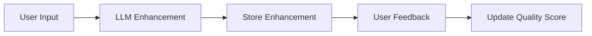

# AI Learning System Documentation

## Overview

The Zeidgeist Prompter now includes a sophisticated learning system that gradually reduces dependency on external LLMs by learning from successful enhancement patterns. The system analyzes user feedback and LLM responses to build a knowledge base of effective prompt transformations.

## Architecture

### Core Components

#### 1. **Pattern Extractor** (`app/lib/learning/pattern-extractor.ts`)
- Analyzes successful enhancements to identify reusable patterns
- Extracts transformations (replacements, additions, restructuring)
- Groups similar patterns for statistical validation
- Requires minimum confidence threshold (70%) and occurrence count (3+)

#### 2. **Learning Service** (`app/lib/learning/learning-service.ts`)
- Orchestrates the learning cycle
- Manages pattern storage and quality updates
- Tracks system metrics (LLM dependency, accuracy)
- Determines when to use local vs. LLM enhancement

#### 3. **Adaptive Enhancer** (`app/lib/learning/adaptive-enhancer.ts`)
- Applies learned patterns to new prompts
- Supports three modes:
  - **Learned**: Pure pattern-based enhancement (80%+ confidence)
  - **Hybrid**: Combines patterns with templates (60-80% confidence)
  - **Fallback**: Defers to LLM (below 60% confidence)

#### 4. **Learning Scheduler** (`app/lib/learning/learning-scheduler.ts`)
- Manages periodic learning cycles
- Configurable interval (default: 24 hours)
- Provides manual trigger capability
- Tracks learning metrics and progress

## How It Works

### 1. Data Collection Phase


- Every LLM enhancement is stored with context
- User feedback (1-5 score) is linked to enhancements
- Successful patterns (score ≥ 4) are marked for learning

### 2. Pattern Extraction Phase
```typescript
// Example pattern extraction
Original: "create website"
Enhanced: "create a responsive website with modern UI/UX design..."

Extracted Pattern:
{
  type: 'replacement',
  from: 'website',
  to: 'responsive website',
  keywords: ['create', 'website'],
  confidence: 0.85
}
```

### 3. Learning Application Phase
The system applies patterns based on confidence levels:
- **High Confidence (≥80%)**: Use learned patterns exclusively
- **Medium Confidence (60-80%)**: Hybrid approach
- **Low Confidence (<60%)**: Fallback to LLM

## Database Schema

### Training Examples Table
```sql
CREATE TABLE training_examples (
  id SERIAL PRIMARY KEY,
  original_prompt TEXT,
  enhanced_prompt TEXT,
  category VARCHAR(50),
  keywords TEXT,
  quality_score DECIMAL(3,2),
  usage_count INTEGER,
  metadata JSONB,
  created_at TIMESTAMP,
  updated_at TIMESTAMP
);
```

### Enhancement Logs Table
```sql
CREATE TABLE enhancement_logs (
  id SERIAL PRIMARY KEY,
  original_prompt TEXT,
  enhanced_prompt TEXT,
  source VARCHAR(50),
  enhancement_model VARCHAR(100),
  response_time INTEGER,
  context TEXT,
  created_at TIMESTAMP
);
```

### Feedback Table
```sql
CREATE TABLE feedback (
  id SERIAL PRIMARY KEY,
  enhancement_id INTEGER REFERENCES enhancement_logs(id),
  successful BOOLEAN,
  score INTEGER CHECK (score >= 1 AND score <= 5),
  comment TEXT,
  created_at TIMESTAMP
);
```

## API Endpoints

### Trigger Learning Cycle
```bash
POST /api/learning/trigger
Content-Type: application/json

{
  "force": true
}

Response:
{
  "success": true,
  "message": "Learning cycle triggered successfully",
  "metrics": {
    "totalPatterns": 150,
    "newPatternsLearned": 12,
    "llmDependencyScore": 0.45,
    "accuracyScore": 0.82
  }
}
```

### Get Learning Status
```bash
GET /api/learning/status

Response:
{
  "success": true,
  "stats": {
    "scheduler": {
      "isRunning": true,
      "lastRunTime": "2024-01-15T02:00:00Z",
      "nextRunTime": "2024-01-16T02:00:00Z"
    },
    "enhancer": {
      "totalEnhancements": 1000,
      "localEnhancements": 450,
      "averageConfidence": 0.78
    },
    "metrics": {
      "totalPatterns": 150,
      "llmDependencyScore": 0.45,
      "accuracyScore": 0.82
    }
  },
  "summary": {
    "isActive": true,
    "llmIndependence": "55.0%",
    "localAccuracy": "82.0%",
    "totalPatterns": 150,
    "recentLocalEnhancements": 450
  }
}
```

## Configuration

### Cloudflare Worker Cron Schedule
The learning cycle runs automatically via Cloudflare Workers. Configure in `wrangler.api.toml`:

```toml
[[triggers.crons]]
# Daily at 2 AM UTC
crons = ["0 2 * * *"]

# Every 6 hours (for aggressive learning)
# crons = ["0 */6 * * *"]
```

### Environment Variables
```env
DATABASE_URL=postgres://...
LEARNING_ENABLED=true
LEARNING_INTERVAL_HOURS=24
MIN_CONFIDENCE_THRESHOLD=0.7
```

## Monitoring Progress

### Key Metrics

1. **LLM Independence Score**: Percentage of enhancements handled locally
   - Target: >70% within 3 months
   - Current: Tracked in real-time

2. **Local Accuracy**: Success rate of pattern-based enhancements
   - Target: >85% accuracy
   - Measured by user feedback scores

3. **Pattern Growth**: Number of high-quality patterns learned
   - Expected: 10-20 new patterns daily initially
   - Stabilizes as system matures

### Success Indicators

- Decreasing LLM API calls over time
- Increasing local enhancement confidence
- Positive user feedback on local enhancements
- Reduced response times (local: ~50ms vs LLM: ~2000ms)

## Pattern Categories

The system learns patterns in these categories:
- **Website**: Web development, UI/UX enhancements
- **Writing**: Content creation, documentation
- **Planning**: Project management, organization
- **Coding**: Programming, technical implementations
- **Analysis**: Data analysis, research tasks
- **General**: Cross-domain enhancements

## Example Learned Patterns

### Simple Replacements
```
"create website" → "create responsive website"
"write article" → "write engaging article"
"analyze data" → "analyze data with insights"
```

### Contextual Additions
```
"build app" → "build app with user authentication and responsive design"
"plan project" → "plan project with timeline, milestones, and deliverables"
```

### Structural Improvements
```
"help with X" → "provide comprehensive assistance with X including:
1. Detailed analysis
2. Step-by-step implementation
3. Best practices
4. Common pitfalls to avoid"
```

## Maintenance

### Regular Tasks

1. **Monitor Learning Metrics**
   - Check `/api/learning/status` weekly
   - Review pattern quality scores
   - Identify underperforming patterns

2. **Database Maintenance**
   - Archive old enhancement logs (>90 days)
   - Vacuum analyze tables monthly
   - Monitor table sizes

3. **Pattern Curation**
   - Review low-confidence patterns
   - Merge similar patterns
   - Remove outdated patterns

### Troubleshooting

**Issue**: High LLM dependency persists
- Check pattern confidence thresholds
- Review feedback collection rate
- Ensure learning cycles are running

**Issue**: Low local accuracy
- Analyze failed local enhancements
- Adjust pattern matching algorithms
- Review pattern quality thresholds

**Issue**: Slow pattern growth
- Verify enhancement logging
- Check feedback submission rates
- Consider lowering confidence thresholds temporarily

## Future Enhancements

1. **Multi-language Support**
   - Learn patterns for non-English prompts
   - Cross-language pattern transfer

2. **Domain-Specific Models**
   - Specialized patterns for industries
   - Custom learning rates per domain

3. **A/B Testing Framework**
   - Compare local vs. LLM enhancements
   - Automatic quality optimization

4. **Pattern Sharing Network**
   - Export/import pattern sets
   - Community pattern library

5. **Advanced Analytics**
   - Pattern effectiveness tracking
   - User preference learning
   - Predictive enhancement selection
