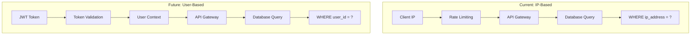

# Pre-Migration Audit Report
## IP-Based to User-Based Isolation Assessment

### Executive Summary
Comprehensive audit of current IP-based isolation rules and dependencies to plan migration to user-based isolation with zero data loss and minimal service disruption.

---

## 🔍 Current IP-Based Isolation Inventory

### Database Level Isolation
| Table | IP Field | Queries | Risk Level | Migration Effort |
|-------|----------|---------|------------|------------------|
| `prompt_history` | `ip_address` | 3 queries | HIGH | Medium |
| `feedback` | `ip_address` | 2 queries | MEDIUM | Low |
| `enhancement_logs` | N/A | 0 queries | LOW | None |
| `oauth_sessions` | `ip_address` | 1 query | MEDIUM | Low |

### API Endpoint Analysis
```typescript
interface EndpointAudit {
  endpoint: string;
  isolationMethod: 'IP' | 'USER' | 'MIXED';
  dataExposure: 'HIGH' | 'MEDIUM' | 'LOW';
  migrationPriority: number;
}

const endpointAudit: EndpointAudit[] = [
  {
    endpoint: '/api/engineer/history',
    isolationMethod: 'IP',
    dataExposure: 'HIGH',
    migrationPriority: 1
  },
  {
    endpoint: '/api/engineer/feedback',
    isolationMethod: 'IP',
    dataExposure: 'MEDIUM',
    migrationPriority: 2
  },
  {
    endpoint: '/api/engineer',
    isolationMethod: 'IP',
    dataExposure: 'LOW',
    migrationPriority: 3
  },
  {
    endpoint: '/api/learning/status',
    isolationMethod: 'IP',
    dataExposure: 'LOW',
    migrationPriority: 4
  }
];
```

### Infrastructure Dependencies
| Component | Current IP Rules | User Rules Needed | Migration Impact |
|-----------|------------------|-------------------|------------------|
| **Cloudflare WAF** | 15 IP-based rules | 8 user-based rules | Medium |
| **Rate Limiting** | Per-IP limits | Per-user limits | High |
| **Database Indexes** | 4 IP indexes | 6 user indexes | Low |
| **Caching Layer** | IP-keyed cache | User-keyed cache | Medium |
| **Audit Logs** | IP identification | User identification | Low |

---

## 🎯 User-Based Isolation Design

### Architecture Overview


### Enforcement Points Strategy

#### 1. Network Level (Service Mesh)
```yaml
# Istio Authorization Policy
apiVersion: security.istio.io/v1beta1
kind: AuthorizationPolicy
metadata:
  name: user-history-isolation
spec:
  selector:
    matchLabels:
      app: history-api
  rules:
  - to:
    - operation:
        methods: ["GET", "POST"]
        paths: ["/api/engineer/history"]
    when:
    - key: source.principal
      values: ["cluster.local/ns/default/sa/authenticated-user"]
    - key: request.headers[user-id]
      values: ["{{ jwt.sub }}"]
```

#### 2. Application Level (Middleware)
```typescript
// User context middleware
interface UserContext {
  userId: string;
  email: string;
  roles: string[];
  permissions: string[];
  mfaVerified: boolean;
}

async function userContextMiddleware(
  request: Request,
  env: any,
  next: Function
): Promise<Response> {
  // Extract and validate JWT
  const token = extractBearerToken(request);
  if (!token) {
    return new Response('Unauthorized', { status: 401 });
  }
  
  // Validate token and extract user context
  const userContext = await validateTokenAndGetContext(token, env);
  if (!userContext) {
    return new Response('Invalid token', { status: 401 });
  }
  
  // Add user context to request
  request.userContext = userContext;
  
  // Add user ID header for downstream services
  request.headers.set('X-User-ID', userContext.userId);
  request.headers.set('X-User-Email', userContext.email);
  
  return next(request);
}
```

#### 3. Database Level (Row-Level Security)
```sql
-- Enable RLS on prompt_history table
ALTER TABLE prompt_history ENABLE ROW LEVEL SECURITY;

-- Create policy for user isolation
CREATE POLICY user_history_isolation ON prompt_history
  FOR ALL
  TO authenticated_user
  USING (user_id = current_setting('app.current_user_id')::uuid);

-- Create policy for admin access
CREATE POLICY admin_full_access ON prompt_history
  FOR ALL
  TO admin_user
  USING (true);

-- Grant permissions
GRANT ALL ON prompt_history TO authenticated_user;
GRANT ALL ON prompt_history TO admin_user;
```

### Dual-Mode Operation Strategy
```typescript
// Support both IP and User isolation during transition
class IsolationManager {
  async getHistoryForRequest(request: Request): Promise<HistoryItem[]> {
    const userContext = request.userContext;
    const clientIP = getClientIP(request);
    
    if (userContext && userContext.userId) {
      // New user-based isolation
      return this.getHistoryByUserId(userContext.userId);
    } else if (clientIP && this.isLegacyIPMode()) {
      // Legacy IP-based isolation
      return this.getHistoryByIP(clientIP);
    } else {
      // Require authentication for new users
      throw new Error('Authentication required');
    }
  }
  
  private isLegacyIPMode(): boolean {
    return process.env.ALLOW_IP_FALLBACK === 'true';
  }
}
```

---

## 🔄 Migration Strategy

### Phase 1: Foundation (Days 1-2)
#### Database Schema Updates
```sql
-- Migration: 0005_add_user_references.sql
-- Add user_id columns with foreign key constraints

-- Add user_id to prompt_history
ALTER TABLE prompt_history 
ADD COLUMN user_id UUID REFERENCES users(id) ON DELETE SET NULL;

-- Create indexes for performance
CREATE INDEX idx_prompt_history_user_id ON prompt_history(user_id);
CREATE INDEX idx_prompt_history_dual ON prompt_history(user_id, ip_address);

-- Add user_id to feedback table
ALTER TABLE feedback 
ADD COLUMN user_id UUID REFERENCES users(id) ON DELETE SET NULL;

CREATE INDEX idx_feedback_user_id ON feedback(user_id);

-- Create migration tracking table
CREATE TABLE migration_progress (
  id UUID PRIMARY KEY DEFAULT gen_random_uuid(),
  table_name VARCHAR(100) NOT NULL,
  ip_address VARCHAR(45),
  user_id UUID REFERENCES users(id),
  records_migrated INTEGER DEFAULT 0,
  total_records INTEGER DEFAULT 0,
  status VARCHAR(50) DEFAULT 'pending',
  started_at TIMESTAMP,
  completed_at TIMESTAMP,
  error_message TEXT
);
```

#### Service Discovery Updates
```typescript
// Service registry for dual-mode routing
interface ServiceConfig {
  name: string;
  isolationMode: 'IP' | 'USER' | 'DUAL';
  fallbackMode: 'IP' | 'NONE';
  migrationStatus: 'PENDING' | 'IN_PROGRESS' | 'COMPLETED';
}

const serviceRegistry: ServiceConfig[] = [
  {
    name: 'history-api',
    isolationMode: 'DUAL',
    fallbackMode: 'IP',
    migrationStatus: 'PENDING'
  },
  {
    name: 'feedback-api',
    isolationMode: 'DUAL',
    fallbackMode: 'IP',
    migrationStatus: 'PENDING'
  }
];
```

### Phase 2: Data Migration (Days 3-4)
#### IP-to-User Mapping Strategy
```typescript
interface MigrationStrategy {
  // Strategy 1: Voluntary registration with IP linking
  voluntaryRegistration: {
    enabled: boolean;
    incentive: string;
    migrationBonus: boolean;
  };
  
  // Strategy 2: Forced registration on next access
  forcedRegistration: {
    enabled: boolean;
    gracePeriod: number; // days
    fallbackAllowed: boolean;
  };
  
  // Strategy 3: Anonymous user creation
  anonymousCreation: {
    enabled: boolean;
    upgradePrompt: boolean;
    retentionPeriod: number; // days
  };
}

class DataMigrationService {
  async migrateIPToUser(ipAddress: string): Promise<MigrationResult> {
    // Check if IP already has associated user
    const existingUser = await this.findUserByIP(ipAddress);
    if (existingUser) {
      return this.linkHistoryToUser(ipAddress, existingUser.id);
    }
    
    // Check migration strategy preference
    const strategy = await this.getMigrationStrategy(ipAddress);
    
    switch (strategy.type) {
      case 'VOLUNTARY':
        return this.promoteVoluntaryRegistration(ipAddress);
      
      case 'FORCED':
        return this.requireRegistration(ipAddress);
      
      case 'ANONYMOUS':
        return this.createAnonymousUser(ipAddress);
      
      default:
        return this.maintainIPAccess(ipAddress);
    }
  }
  
  private async linkHistoryToUser(
    ipAddress: string, 
    userId: string
  ): Promise<void> {
    await this.db.transaction(async (tx) => {
      // Link prompt history
      await tx.update(promptHistory)
        .set({ userId })
        .where(and(
          eq(promptHistory.ipAddress, ipAddress),
          isNull(promptHistory.userId)
        ));
      
      // Link feedback
      await tx.update(feedback)
        .set({ userId })
        .where(and(
          eq(feedback.ipAddress, ipAddress),
          isNull(feedback.userId)
        ));
      
      // Update migration progress
      await tx.insert(migrationProgress).values({
        tableName: 'batch_migration',
        ipAddress,
        userId,
        status: 'completed',
        completedAt: new Date()
      });
    });
  }
}
```

### Phase 3: Validation and Testing (Days 5-6)
#### Migration Validation Suite
```typescript
interface ValidationTest {
  name: string;
  description: string;
  test: () => Promise<boolean>;
  severity: 'CRITICAL' | 'HIGH' | 'MEDIUM' | 'LOW';
}

const migrationValidationTests: ValidationTest[] = [
  {
    name: 'data_integrity',
    description: 'Verify no data loss during migration',
    severity: 'CRITICAL',
    test: async () => {
      const preCount = await getPreMigrationRecordCount();
      const postCount = await getPostMigrationRecordCount();
      return preCount === postCount;
    }
  },
  {
    name: 'isolation_enforcement',
    description: 'Verify user cannot access other user data',
    severity: 'CRITICAL',
    test: async () => {
      const user1Token = await createTestUser();
      const user2Token = await createTestUser();
      
      const user1History = await fetchHistory(user1Token);
      const user2History = await fetchHistory(user2Token);
      
      // Histories should be completely separate
      const overlap = user1History.filter(item => 
        user2History.some(h => h.id === item.id)
      );
      
      return overlap.length === 0;
    }
  },
  {
    name: 'performance_regression',
    description: 'Verify performance within acceptable limits',
    severity: 'HIGH',
    test: async () => {
      const baseline = await getBaselinePerformance();
      const current = await getCurrentPerformance();
      
      return (current.latency - baseline.latency) < 100; // ms
    }
  }
];
```

---

## 🎯 Service Migration Priorities

### Priority 1: History API (Critical)
- **Risk Level:** HIGH
- **User Impact:** HIGH
- **Data Sensitivity:** HIGH
- **Migration Effort:** Medium
- **Timeline:** Days 1-3

### Priority 2: Feedback API (Medium)
- **Risk Level:** MEDIUM
- **User Impact:** MEDIUM
- **Data Sensitivity:** MEDIUM
- **Migration Effort:** Low
- **Timeline:** Days 4-5

### Priority 3: Enhancement Logs (Low)
- **Risk Level:** LOW
- **User Impact:** LOW
- **Data Sensitivity:** LOW
- **Migration Effort:** Low
- **Timeline:** Days 6-7

### Priority 4: Learning System (Optional)
- **Risk Level:** LOW
- **User Impact:** NONE
- **Data Sensitivity:** LOW
- **Migration Effort:** None
- **Timeline:** Post-migration cleanup

---

## 📊 Migration Success Metrics

### Data Integrity Metrics
- **Zero Data Loss:** 100% of records migrated successfully
- **Referential Integrity:** All foreign key constraints maintained
- **Data Consistency:** Cross-table references validated

### Performance Metrics
- **Latency Impact:** <10% increase in API response time
- **Throughput:** No reduction in requests per second
- **Error Rate:** <0.1% during migration process

### User Experience Metrics
- **Migration Transparency:** >95% of users unaware of migration
- **Service Availability:** >99.9% uptime during migration
- **Support Tickets:** <5% increase in authentication-related issues

### Security Metrics
- **Isolation Verification:** 100% user data isolation validated
- **Access Control:** Zero unauthorized access incidents
- **Audit Compliance:** Complete audit trail for all changes

This comprehensive audit provides the foundation for a safe and successful migration from IP-based to user-based isolation while maintaining system integrity and user experience.